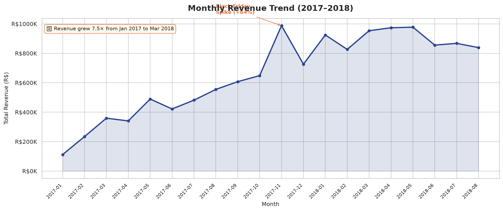
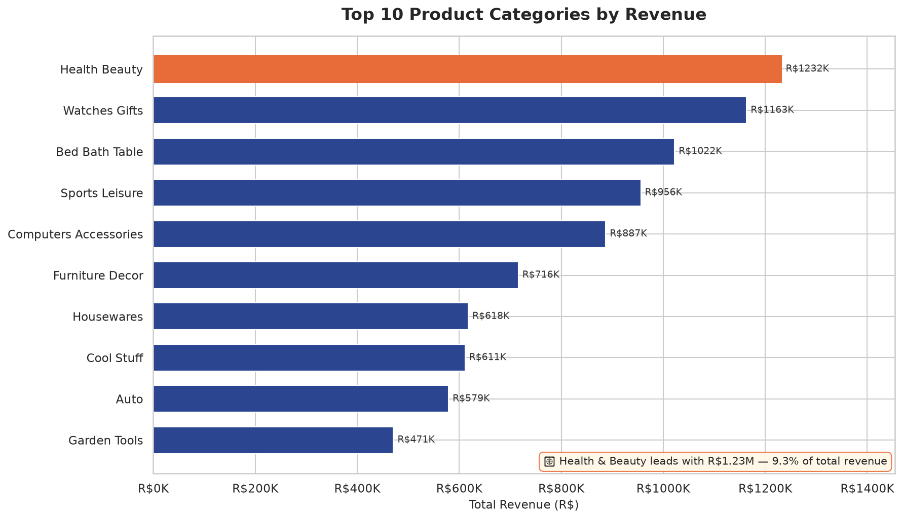
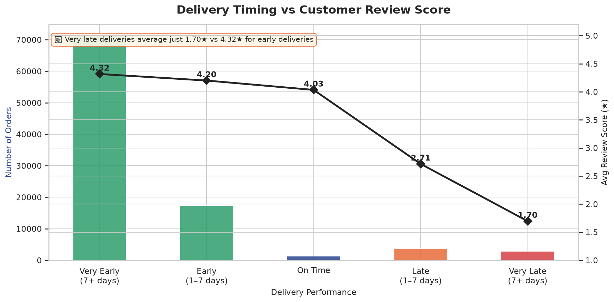
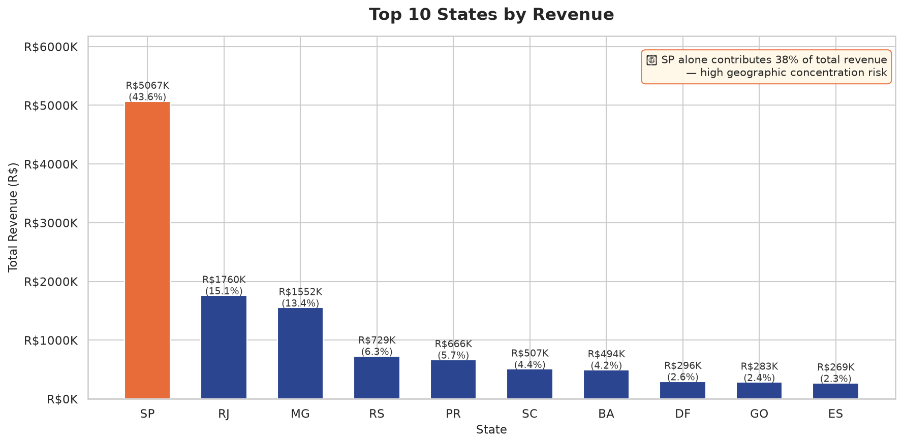
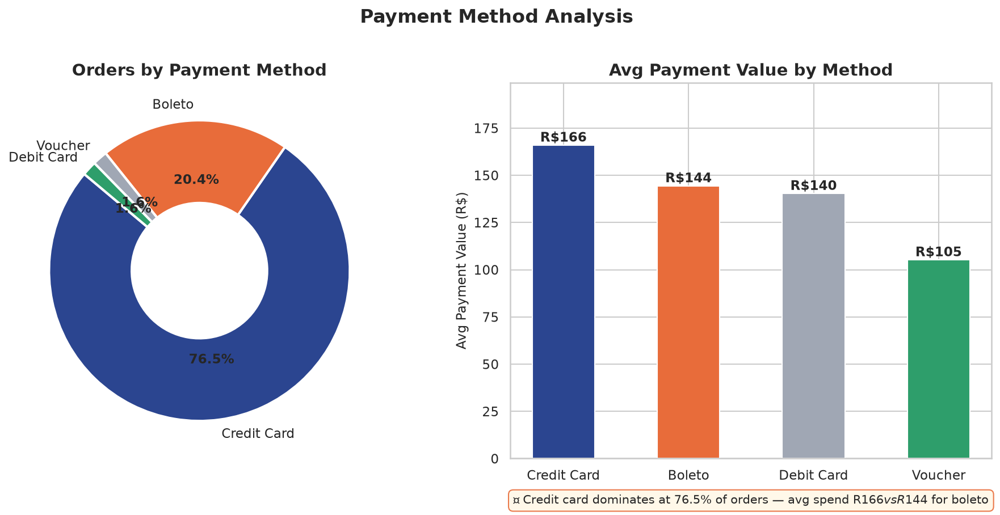

# 🛒 E-Commerce Sales & Customer Analytics

A full end-to-end data analytics project analyzing **96,470 orders** from Olist, Brazil's largest e-commerce marketplace. This project covers the complete analyst workflow — from raw data cleaning to SQL analysis and Python visualizations.

---

## 📌 Business Problem

Olist operates across all Brazilian states with hundreds of product categories and thousands of sellers. This analysis answers the following business questions:

- Which states and product categories drive the most revenue?
- How has the business grown month over month?
- What is the impact of late deliveries on customer satisfaction?
- Which payment methods do customers prefer?
- Are premium customers receiving better service than budget customers?

---

## 🛠️ Tools & Technologies

| Tool | Purpose |
|---|---|
| Python (pandas) | Data cleaning & engineering |
| SQLite / SQL | Business question analysis |
| Matplotlib & Seaborn | Data visualization |
| GitHub | Version control & portfolio hosting |

---

## 📂 Project Structure

```
olist-project/
│
├── data/
│   ├── olist_master_clean.csv       # Final cleaned dataset (output of Phase 1)
│   └── ...                          # Original Kaggle CSVs (not uploaded — see below)
│
├── charts/
│   ├── 01_monthly_revenue_trend.png
│   ├── 02_top_categories_revenue.png
│   ├── 03_delivery_vs_review_score.png
│   ├── 04_revenue_by_state.png
│   └── 05_payment_analysis.png
│
├── 01_data_cleaning.py              # Data cleaning & feature engineering
├── 02_sql_analysis.py               # 11 SQL business questions
├── 03_visualizations.py             # Matplotlib visualizations
├── requirements.txt                 # Python dependencies
├── .gitignore                       # Ignored files/folders
└── README.md
```

---

## 📊 Dataset

- **Source:** [Brazilian E-Commerce Public Dataset by Olist](https://www.kaggle.com/datasets/olistbr/brazilian-ecommerce)
- **Size:** 96,470 delivered orders across 8 relational tables
- **Period:** September 2016 – August 2018
- **Tables used:** orders, order_items, customers, products, payments, reviews, sellers, category translations

> The raw CSV files are not included in this repo due to size. Download them from Kaggle and place them in the `data/` folder before running the scripts. The generated `olist_master_clean.csv` is a local artifact output from Phase 1 and should also not be committed.

---

## 🔍 Phase 1 — Data Cleaning

**Script:** `01_data_cleaning.py`

Key steps performed:
- Loaded and profiled all 8 CSV tables
- Filtered to `delivered` orders only (removed cancelled, unavailable, etc.)
- Converted all timestamp columns to `datetime` dtype
- Engineered new features:
  - `delivery_delay_days` — actual vs estimated delivery (positive = late)
  - `processing_time_hrs` — time from purchase to approval
  - `order_yearmonth` — for time series analysis
- Aggregated order items and payments from line-level to order-level
- Translated product categories from Portuguese to English
- Deduplicated reviews and classified satisfaction (Satisfied / Neutral / Dissatisfied)
- Joined all 8 tables into a single `olist_master_clean.csv`

**Output:** 96,470 rows × 28 columns, ready for analysis

---

## 🗄️ Phase 2 — SQL Analysis

**Script:** `02_sql_analysis.py`

11 business questions answered using SQL (via SQLite in Python). The analysis demonstrates key SQL skills including:
- **Aggregations & Grouping** (`COUNT`, `SUM`, `AVG`)
- **CASE Expressions** (for conditional logic and data bucketing)
- **Window Functions** (for calculating percentage shares)
- **CTEs (Common Table Expressions)** (for pre-aggregating data cleanly)
- **INNER JOINs** (to merge fact and dimension tables)

| # | Question | Key Finding |
|---|---|---|
| 1 | Overall KPIs | R$13.22M revenue, 96,470 orders, 4.16 avg rating |
| 2 | Revenue by state | SP alone = 38% of total revenue |
| 3 | Monthly trend | Revenue grew 7.5× from Jan 2017 to Mar 2018 |
| 4 | Top categories | Health & Beauty leads with R$1.23M |
| 5 | Late delivery by state | AL has the highest late delivery rate at 21.4%, with late orders averaging 9.5 days late |
| 6 | Worst rated categories | Office Furniture averages just 3.65★ |
| 7 | Payment methods | 76.5% of orders use credit card |
| 8 | Delivery performance | Very late orders average 1.70★ vs 4.32★ for early |
| 9 | Order value segments | Premium customers rate lower (4.03★) than budget (4.22★) despite arriving 12.2 avg_days_early |
| 10 | Seasonality (2017) | November was the peak month (Black Friday effect) |
| 11 | Category Translations | Uses INNER JOIN to output both Portuguese and English category names |

---

## 📈 Phase 3 — Visualizations

**Script:** `03_visualizations.py`

### Monthly Revenue Trend (2017–2018)

> Revenue grew 7.5× in 14 months. The November 2017 Black Friday spike shows a 64% month-over-month jump.

---

### Top 10 Product Categories by Revenue

> Health & Beauty leads at R$1.23M. Watches & Gifts has the highest average order value at R$212.

---

### Delivery Performance vs Customer Review Score

> The most critical operational insight: very late deliveries average just 1.70★. On-time or early deliveries consistently score above 4.0★.

---

### Revenue by State

> São Paulo contributes 38% of total revenue — a significant geographic concentration risk for the business.

---

### Payment Method Analysis

> Credit card dominates at 76.5% of orders with an average spend of R$166, compared to R$144 for boleto (bank slip).

---


## 💡 Key Business Insights & Recommendations

**1. Delivery is the #1 driver of customer satisfaction**
Late deliveries drop review scores from 4.32★ to 1.70★. Improving last-mile logistics — especially in northern states like AL (21.4% late rate) and MA (17.4%) — would have the highest impact on overall ratings.

**2. Geographic concentration is a risk**
São Paulo generates 38% of revenue. A disruption in SP logistics or a regional competitor entering that market would significantly impact the business. Expanding marketing investment in MG, RS, and PR could diversify revenue.

**3. Black Friday is the biggest revenue event**
November 2017 saw a 64% revenue spike. The business should plan inventory, staffing, and logistics capacity well in advance for Q4 every year.

**4. Premium customers are underserved**
Orders over R$500 rate the experience lower (4.03★) than orders under R$50 (4.22★). High-value customers likely have higher expectations around packaging, delivery speed, and communication — areas worth investing in.

**5. Health & Beauty is the star category**
Highest revenue (R$1.23M) with a strong 4.24★ rating. This category deserves increased seller recruitment and marketing spend.

---

## 🚀 How to Run This Project

**Prerequisites:**
```
pip install pandas numpy matplotlib seaborn
```

**Steps:**
1. Download the dataset from [Kaggle](https://www.kaggle.com/datasets/olistbr/brazilian-ecommerce)
2. Place all CSV files in the `data/` folder
3. Run scripts in order:
```bash
python 01_data_cleaning.py         # Clean data → outputs olist_master_clean.csv
python 02_sql_analysis.py          # SQL analysis → prints results to terminal
python 03_visualizations.py        # Charts → saves PNGs to charts/ folder
```

